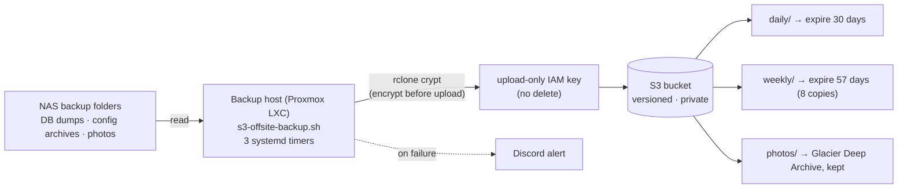

# AWS S3 Off-site Homelab Backup

Encrypted, ransomware-resistant off-site backups of a self-hosted homelab (Proxmox, Unraid and self-hosted Docker services) to Amazon S3, for about $1 a month.

**Status:** running daily since November 2026. 226 GiB seeded, and the restore was verified by checksum on a separate machine. Still to do: a Deep Archive photo restore test and the first full month's real cost.

---

## The problem

Every backup in the lab lived on the same NAS as the data it protected: database dumps, Docker configs, the hypervisor config and a 226 GiB photo library. One hardware failure, fire or ransomware incident would take the originals and the backups together. That breaks the **3-2-1 rule**: three copies, two kinds of storage, one off-site.

## What I built

| Data | How often | Kept | Storage class |
|---|---|---|---|
| 8 database dumps | daily | 30 days | S3 Standard |
| Docker config archive + Proxmox host config | weekly | 8 copies | S3 Standard |
| Photo originals (Immich) | daily, new files only | forever | Glacier Deep Archive |

**First run:**

| Job | Data | Time |
|---|---|---|
| Daily | 8 dumps | 21 s |
| Weekly | 1.2 GB config archive | 49 s |
| Photos | 226 GiB, 31,909 files | 1 h 25 min (~45 MB/s) |

## Design decisions

**1. The server's key can upload but can't delete.**
The IAM policy ([`aws/iam-policy.json`](aws/iam-policy.json)) allows list, upload and read on one bucket, and nothing else. There's no `s3:DeleteObject`. Old copies are removed by **lifecycle rules inside the bucket**, not by the client. If the backup host is compromised, the attacker gets a key that can't destroy the backups, and versioning keeps the previous copy of anything overwritten.

That's also why the script uses `rclone copy`, never `rclone sync`. `sync` deletes files in the destination that were deleted at the source, so it would carry an accidental or malicious deletion straight into the backup.

**2. Encrypted before it leaves the server.**
S3's default encryption (SSE-S3) protects the disks, but AWS holds those keys. Everything here also goes through **rclone crypt** with a password that exists only in my password manager. Anyone with access to the AWS account still sees only ciphertext.

File *names* stay readable (contents are encrypted) on purpose: the lifecycle rules match on the `daily/`, `weekly/` and `photos/` prefixes, and encrypting the names would break them.

**3. Storage class chosen by how long the data lives.**
- **Glacier Deep Archive** costs about 23 times less than Standard, but has a 180-day minimum charge and a 12–48 hour restore.
- **Photos** are kept forever and only needed in a disaster, so they go to Deep Archive.
- **Configs and dumps** live 30–57 days. In Glacier they'd be billed for 90–180 days, which would cost *more*, so they stay in Standard.

The rules are in [`aws/lifecycle.json`](aws/lifecycle.json). They also abort failed multipart uploads after 7 days, which would otherwise be billed invisibly.

**4. I sized the data before moving it to the cloud.**
The "config" archive was 4.2 GB. It turned out to hold AI model files, dated database copies, caches and **some files with live secrets** (including a VPN private key). I excluded the junk and the secrets, cut it to 1.2 GB, locked down file permissions, and rotated the exposed keys. Only then did I upload.

**5. It fails loudly.**
The script refuses to upload a dump older than 36 hours. If the nightly dump job breaks, the off-site job fails too and sends a Discord alert, instead of quietly re-uploading an old file forever. The systemd timers catch up after downtime (`Persistent=true`). The photo job uses `flock`, so a long upload and the next night's run never overlap.

## Restore, tested

A backup isn't a backup until you've restored from it. On 2026-11-14:

1. I downloaded an encrypted 114 MB database dump from the S3 console.
2. I decrypted it on a **different machine** using **only the password from my password manager**, with a one-off rclone crypt remote. Decrypting took 0.3 s.
3. Its SHA-256 matched the original on the NAS exactly.

Steps for both cases, including Deep Archive retrieval, are in [`docs/restore.md`](docs/restore.md).

## Cost

| Item | Price (us-east-1) |
|---|---|
| S3 Standard | $0.023 per GB-month |
| Glacier Deep Archive | $0.00099 per GB-month (180-day minimum) |
| Data out | free for the first 100 GB a month, then $0.09 per GB |

- **Estimate:** about **$0.60–1.15 a month** all-in, plus about $0.85 one time for the 31,909 photo uploads.
- **A full photo restore** would cost about $14, almost all of it download fees.
- **Real numbers:** I'll add them after the first full month.

## Known limits and next steps

- **Short overwrite window for configs and dumps.** The key can't delete, but it can overwrite a file. The previous version is kept for only 1 day in `daily/` and `weekly/`. **Next:** keep old versions for 7–14 days, or enable S3 Object Lock.
- **Monitoring checks failures, not silence.** **Next:** add a staleness check on the last-success stamp files the script writes.
- **The NAS boot drive** isn't backed up automatically yet.
- **The backup host is the speed limit** (~45 MB/s: NAS read plus encryption), not the internet connection. That's fine for nightly increments.
- **Photo recovery time** is up to 48 hours plus download. That's acceptable for a disaster-only copy, and it's the price of the cheapest storage tier.

## Repository

| Path | What |
|---|---|
| [`scripts/s3-offsite-backup.sh`](scripts/s3-offsite-backup.sh) | The upload script: `daily`, `weekly` or `photos`, with `--dry-run` |
| [`systemd/`](systemd/) | The three services and timers |
| [`aws/iam-policy.json`](aws/iam-policy.json) | Upload-only IAM policy |
| [`aws/lifecycle.json`](aws/lifecycle.json) | Retention and Deep Archive rules |
| [`docs/setup.md`](docs/setup.md) | How it was set up, step by step |
| [`docs/restore.md`](docs/restore.md) | How to get data back |

Account numbers, the real bucket name, internal addresses and credentials are deliberately left out. `<your-bucket>` marks the bucket name.

## Foundation: the AWS account itself

Before building anything, I locked down the account:
- **Root user:** MFA on, no access keys, used only as break-glass.
- **Daily admin identity:** a separate one with MFA, with permissions granted through a group rather than on the user.
- **Cost guardrails:** a zero-spend budget, a $5 monthly budget with a forecast alert, Free Tier usage alerts and CloudWatch billing alerts.

## Skills shown

AWS S3 (versioning, lifecycle, storage classes, Block Public Access) · IAM least privilege · client-side encryption · Linux (bash, systemd) · rclone · backup design (3-2-1, RPO/RTO, restore testing) · cost analysis
